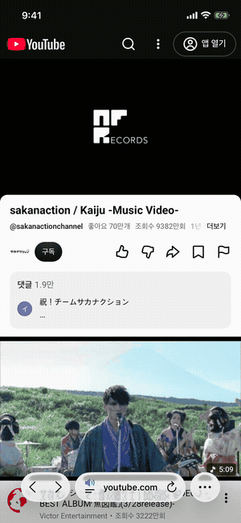
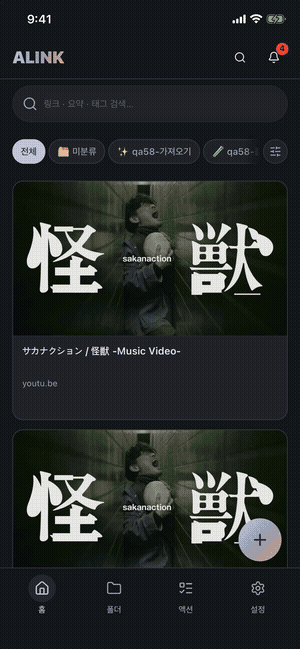

# ALink · 에이링크

**AI가 도와주는 북마크 아카이브 서비스**

흩어진 링크를 간편하게 저장하고, AI의 도움으로 요약하고 정리하세요.
키워드로 북마크를 다시 찾고, 저장한 정보를 액션으로 이어갈 수 있습니다.

[웹 바로가기](https://archivelink.app) · [App Store](https://apps.apple.com/kr/app/%EC%97%90%EC%9D%B4%EB%A7%81%ED%81%AC-alink-ai%EA%B0%80-%EB%8F%84%EC%99%80%EC%A3%BC%EB%8A%94-%EB%B6%81%EB%A7%88%ED%81%AC-%EC%95%84%EC%B9%B4%EC%9D%B4%EB%B8%8C/id6788230955) · [사용 가이드](https://warp-raft-63c.notion.site/ALink-Tips-412d602d12548000ab51c9da56783374)

## 소개 영상

[ALink Tips](https://warp-raft-63c.notion.site/ALink-Tips-412d602d12548000ab51c9da56783374)의 실제 사용 영상입니다. 미리보기를 클릭하면 가이드의 원본 영상으로 이동합니다.

| 빠른 아카이브 | 간편한 검색 |
| :---: | :---: |
|  |  |
| 유튜브, 인스타그램, 브라우저에서 간편하게 저장 | 제목을 몰라도 생각나는 키워드로 검색 |

## Backend

ALink의 API 서버, 링크 수집 Lambda, AWS 인프라 구성을 관리하는 레포지토리입니다.

## Tech Stack

| 분야 | 기술 | 용도 |
| --- | --- | --- |
| Language & Runtime |   | Kotlin 기반 API 서버 |
| Framework |   | 비동기 HTTP 서버 |
| Dependency Injection |  | 의존성 주입 |
| ORM & Database Access |   | SQL DSL과 JDBC 커넥션 풀 |
| Database |   | 데이터 저장과 키워드 검색 인덱스 |
| Migration |  | 데이터베이스 스키마 버전 관리 |
| AI |  | 북마크 요약과 정리 |
| Authentication |  | 토큰 기반 인증 |
| API Documentation |    | API 명세와 인터랙티브 문서 |
| Link Extraction |     | 링크 메타데이터와 본문 추출 |
| Infrastructure |     | 컨테이너 실행, 데이터베이스, 파일 저장과 CDN |
| Infrastructure as Code |   | 인프라 구성과 컨테이너화 |
| Observability |    | 메트릭 노출과 애플리케이션 로그 |
| Testing |    | 도메인·서비스 테스트, 통합 테스트, 커버리지 |
| Build & CI |    | 빌드, 포맷 검사, CI |
